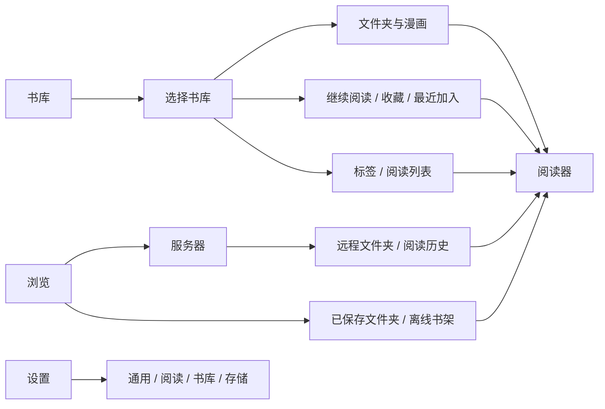

# JamReader UI/UX 改版需求

面向 UI/UX 设计师 · 2026-10-10 · 当前功能与改版范围

**目标：让用户容易找到漫画、开始阅读、管理文件，同时保留已经调好的漫画阅读操作。** 界面外观、信息层级、工具布局可以重新设计，但分页阅读底部导航列表、竖向阅读侧边导航列表原样保留，详见第 5 节。

本文中的“现状”已对照当前代码和测试用例核对；“改版要求”是接下来要达到的目标，并不表示已经实现。本轮没有运行 App 或逐屏截图，不对当前画面的美观、实际手感或无障碍完成度下结论。

**改版方案已定稿（2026-10-14）：** 具体的信息架构、入口安排、视觉 token、组件与页面方案及分批实施计划见 [设计系统](design-system/README.md)。本文继续负责业务需求、数据边界、删除后果与阅读器行为契约；页面结构与入口位置以设计系统为准。已确认纳入本次改版的功能变化：书库首页汇总本地书库的继续阅读（设置中可改为“各书库内”显示）、集合页快捷筛选。

## 1. 产品与使用场景

JamReader 是 iPhone 和 iPad 上的个人漫画阅读与管理工具。漫画来自用户自己的文件、文件夹或 NAS/服务器。

| 用户想做什么 | 产品需要帮助他完成什么 |
| --- | --- |
| 日常阅读 | 找到上次没看完的漫画，继续阅读，退出后记住进度 |
| 整理收藏 | 导入文件，按文件夹、标签、阅读列表找书，修改书名等资料 |
| 阅读 NAS 漫画 | 连接 SMB/WebDAV，浏览文件夹，直接阅读，或为离线使用保存副本 |
| 管理空间 | 看懂哪些是自己的漫画、哪些是可重建缓存，再决定清理什么 |

**已确认的设计方向：本地书库与远程阅读并重；采用现代、安静、内容优先的原生 iOS/iPadOS 风格。** 两类场景都纳入首轮设计，漫画阅读器的既有操作按第 5 节保留。

这是一次现有产品改版，功能扩展的范围边界见第 8 节。

## 2. 先分清这些概念

| 概念 | 用户需要理解的含义 |
| --- | --- |
| App 内书库 | 用户新建的本地收藏空间，漫画文件由 App 保存 |
| 已导入漫画 | App 提供的默认导入书库；与用户新建书库一样，里面是用户文件 |
| 关联文件夹 | 直接使用“文件”App 中选定的文件夹，添加时不复制整份漫画；可用性取决于文件夹权限 |
| 标签 / 阅读列表 | 同一本地书库里的逻辑分组，不复制或移动漫画文件；收藏与页书签也是不同用途 |
| 已保存文件夹 | 远程文件夹的快捷入口；保存这个入口不会下载里面的漫画 |
| 离线副本 | 用户主动保存到本机的远程漫画，仍归属于该服务器，不会自动加入本地书库 |
| 阅读缓存 | 在线阅读产生的临时数据或自动下载副本；存在缓存不等于已加入“离线书架” |

**关联文件夹不等于只读。** 有写入权限时可以向它导入文件、删除其中的漫画；书名、标签、阅读进度等 App 资料仍保存在 App 内。只读时，应保留阅读和资料管理，说明导入、文件删除为何不可用。

“导入书库”与“保存离线副本”必须是可区分的操作。一个远程漫画即使已经能离线打开，也不代表它已经出现在本地书库。

## 3. 功能地图

下面是现有功能关系。**保留功能不等于保留所有入口或每个中间页面。** 保留“书库 / 浏览 / 设置”三个逻辑分区；名称、入口位置和外围页面层级可以优化，入口合并规则见第 6 节。

### 本地书库

| 页面或任务 | 现有能力，要在改版中保留 | 改版要求 |
| --- | --- | --- |
| 书库首页 | 新建书库、关联文件夹、导入文件或文件夹；书库改名、信息、移除或删除 | “添加”的不同方式按用途解释，避免要求新用户先理解存储术语 |
| 书库内容 | 文件夹逐级浏览、系统返回与可点面包屑、点击漫画直接阅读；向当前文件夹导入文件；刷新整库或当前文件夹 | 明确当前位置和导入目标；扫描等维护动作放在次级位置 |
| 找书 | 当前书库搜索文件夹和漫画；排序；iPhone/iPad 均可切换网格与列表 | 标明搜索范围，区分“空文件夹”与“没有搜索结果”；不要暗示能搜索所有服务器 |
| 继续阅读与集合 | 继续阅读默认在书库首页汇总所有本地书库（设置可改为“各书库内”，显示在书库根目录）；收藏、最近加入、标签、阅读列表有独立入口 | 优先展示封面、名称、阅读进度；分组入口易找，避免大量状态标签挤占封面 |
| 漫画管理 | 收藏、已读/未读、1–5 星评分或取消评分、编辑资料、标签/阅读列表、删除文件 | 轻操作与删除分开；常用操作不能只能靠长按发现 |
| 批量管理 | 多选、全选、批量已读/收藏、资料修改、标签/阅读列表增删、导入 ComicInfo | 明确选中数量与作用范围；退出选择模式后恢复普通打开行为 |
| 标签与阅读列表 | 新建、改名、标签颜色、删除分组；加入/移出漫画；搜索与排序 | “移出分组”不能写成“删除漫画”；不把分组设计成复制文件 |
| 资料编辑 | 标题、系列、卷/期、类型；出版信息、作者、角色、简介、备注等；支持读取 ComicInfo.xml | 常用字段在前，详细字段分组展开；批量只改用户勾选的字段；未保存退出要有明确选择 |

现状补充：

- 本地“最近”是**最近加入书库**，时间范围为 7、14、30、90 天；不是阅读历史。设计文案建议直接叫“最近加入”。
- “继续阅读”是已打开但未读完的漫画。第 5 批起由设置 → 书库“继续阅读显示在”决定位置：默认“书库首页”，首页顶部汇总所有本地书库（主卡 + 卡带，卡片写来源书库；“全部”页按书库分组；iPad 为侧栏“继续阅读”行），书库根目录不再显示；选“各书库内”时与原来一致，只在各书库根目录显示。汇总按书库分别查询（每库最多 20 本，首页显示 10 本），以书库 + 行 ID 区分条目，打开后只在同一书库内前后翻本。远程服务器的阅读历史仍在各服务器详情，不并入本地汇总。
- 第 2 批将本地 iPhone 默认改为封面网格，可切列表并保存偏好；辅助功能大字号使用两列网格。当前文件夹提供全部、未读、阅读中、已读、有书签筛选，文件夹不受筛选影响。
- 本地书库搜索当前最多返回 40 个文件夹和 40 本漫画，不是无限完整结果。取消上限或新增全局搜索需另列功能需求。
- 集合内容页可以在当前集合内搜索。第 5 批起收藏、最近加入、标签、阅读列表页也有全部 / 未读 / 阅读中 / 已读 / 有书签快捷筛选（“继续阅读”页本身就是阅读中，不显示筛选）；筛选与搜索可同时生效，空结果写出全部条件（如“最近加入”中没有同时符合“阅读中”和“Night”的漫画）并提供“显示全部”。
- ComicInfo 是漫画文件内的资料。现有范围包括所选漫画、当前列表、整个书库、当前文件夹及其子文件夹；可选“只补空白”或“覆盖已有字段”。改版合并入口时不能合并掉这些范围差异。
- 书库改名和漫画资料编辑只改 App 内显示资料，不会给源文件或文件夹改名；本地文件移动、源文件改名没有现成入口。

### 远程浏览与离线阅读

| 页面或任务 | 现有能力，要在改版中保留 | 改版要求 |
| --- | --- | --- |
| 浏览首页 | 顶部为全部服务器范围的离线书架、已保存文件夹；下方服务器列表显示名称、地址与协议 | 不推测连接状态；空状态仅保留一个“添加服务器” |
| 添加/编辑服务器 | 按协议显示字段与示例；错误保留输入；修改位置或账户前确认清理影响；未保存退出确认 | 保存配置不连接服务器；密码遮蔽 |
| 服务器详情 | 唯一“浏览文件”主按钮从上次目录打开；继续阅读主卡与卡带展示历史；本服务器快捷区保留文件夹、离线书架 | 菜单只保留编辑、清除历史、清理本机下载和删除；历史卡长按可移除单条 |
| 远程目录 | 文件夹大标题、可点面包屑、图钉保存/取消保存、网格/列表、按名称/更新/大小排序 | 不支持文件只计数；显示方式与批量操作收进更多菜单 |
| 单本漫画 | 点封面阅读；菜单按本机副本、本地书库、信息分组；较旧副本有更新和显式打开旧副本入口 | 主动保存的完整副本才显示“已离线”；普通阅读缓存不冒充离线保存 |
| 整个文件夹 | 导入当前文件夹，选择是否包括子文件夹；批量保存或移除当前目录漫画的本机副本 | 开始前说明范围、目标位置；不要把“当前目录”描述成整台服务器 |
| 已保存文件夹 | 按服务器分组、搜索；导航栏编辑支持改名/移除；图钉标记；点击进入目录 | 移除确认明确只删快捷入口，服务器文件保留 |
| 离线书架 | 搜索、全部/需要更新筛选及数量、排序；打开/移除副本；联网时旧副本行尾更新 | 系统报告断网时显示提示、隐藏更新并禁用远程目录入口；不再提供会清历史的整服务器清空操作 |

现状补充：

- 保存服务器配置只验证配置并保存，**不等于已经连接成功**。当前表单没有独立的“测试连接”功能。
- 当前远程目录没有搜索框；不要把递归搜索、跨服务器搜索或远程文件改名/移动/删除画成已有功能。
- ZIP/CBZ 在服务器支持时可边取页面边读；其他格式或不支持这种读取方式时，需要先下载。打开失败不保证总能自动改用另一种方式。
- 准备远程阅读时保留封面、说明完整下载的原因并显示进度；左上 × 取消并返回。失败可重试，或在失败页直接打开已有的服务器编辑表单，保存后关闭阅读器回到目录（打开请求带的是旧的服务器设置）；没有另建阅读器状态机。
- 远程导入仍写入目标书库根目录。当前目录可显示已列出的漫画数量；递归总数在实际导入时统计，没有预扫描总数或目标子文件夹选择器。WebDAV 表单继续保留现有独立端口/服务器路径字段。
- 服务器历史仍使用详情页内已有查询范围；目前没有独立“全部远程历史”集合页。网络路径可用也不代表 NAS 可达，更新失败仍显示实际错误。
- 阅读缓存可能自动清理；主动保存的离线副本受自动清理保护，但用户明确清理下载副本时仍会被删除。
- 远程阅读历史和本地书库进度分别保存；把同一本远程漫画导入书库，不应宣称两份进度会自动同步。
- 离线书架当前没有直接“导入书库”按钮；需回到所在远程目录，再使用漫画的导入操作。设计中复用这条路径，不另造第二套导入流程。

### 设置

| 分类 | 现有设置与功能 |
| --- | --- |
| 通用 | 启动时进入上次使用的分区、书库或浏览；App 版本 |
| 阅读 | 阅读时保持亮屏；共享阅读布局默认值；恢复推荐默认值 |
| 书库 | 最近加入的时间范围、远程文件夹默认导入范围 |
| 存储 | 分为远程下载、可重建数据、你的文件；每行显示大小和清理按钮，后果在确认弹窗说明；顶部占用条仅统计本页可查询的类别 |

“存储”直接进入管理页。不要把用户文件与缓存合成一个“一键清理”。下载上限是自动缓存策略，不能保证 App 总占用永远低于该值；阅读中的文件和主动保存的离线副本会影响可清理空间。

占用条中的用户文件当前只统计默认“已导入漫画”书库，不代表所有书库或整个 App 的总占用。清理远程下载保留服务器文件、阅读历史、进度和书签；清空“已导入漫画”会删除其中的文件与阅读记录，但保留书库。

“阅读时下载完整副本”只影响可流式阅读的远程漫画自动下载，不取消必须先下载才能打开的文件，也不改变用户主动保存离线副本的操作。

## 4. 关键操作流程

以下按现有步骤描述。新设计可以缩短外围流程，但要保留选择的含义、取消路径和最终结果。

| 场景 | 操作顺序 | 成功与异常的判断 |
| --- | --- | --- |
| 第一次导入本地漫画 | 书库 → 添加漫画 → 导入漫画 → 选目标书库 → 选择文件/文件夹 → 系统文件选择 → 任务条 → 打开目标书库 | 整理入库后才算完成；呈现成功、跳过、失败的实际结果。从书库内容页导入文件则直接使用当前书库/文件夹，不重复选目标 |
| 使用现有文件夹 | 添加漫画 → 使用已有文件夹 → 系统授权选择 → 打开书库 → 必要时初始化/扫描 | 文件留在原处；权限失效与书库为空必须分开显示 |
| 继续本地阅读 | 书库首页的继续阅读（或“各书库内”时对应书库的继续阅读）→ 漫画 → 保存的位置 → 退出回原列表 | 返回后封面条目进度更新；保留当前位置与分组，不回到首页 |
| 第一次远程阅读 | 浏览 → 添加服务器 → 保存 → 服务器详情 → 目录 → 漫画 | 可边取边读则打开；需下载则显示准备进度并允许取消；登录/网络/路径错误给对应处理入口 |
| 准备离线阅读 | 远程漫画操作 → 保存离线副本 → 完成 → 离线书架 → 打开 | 只有完整可用副本才标记可离线；失败或中断不冒充完成；较旧副本可提示更新 |
| 远程导入本地书库 | 漫画/文件夹操作 → 导入书库 → 选目标与目录范围 → 下载 → 整理入库 → 打开目标书库 | 结束后能在目标书库找到内容；部分成功、整理入库失败、取消分别反馈 |
| 整理多本漫画 | 内容页 → 选择 → 勾选漫画 → 操作 → 应用 → 完成选择 | 修改目标清楚，未选择的漫画不受影响；移出列表不删除文件 |
| 清理空间 | 设置 → 存储 → 选数据类别 → 阅读影响说明 → 确认 → 清理结果 | 刷新占用与离线状态；正在使用或任务冲突时说明原因，不能假装成功 |

导入允许取消，已经完成的部分要如实反馈。远程导入可在 App 内切换页面时继续，进度入口应保持可找；这不代表已实现退出 App、系统挂起或重启后可靠续传，设计稿不能承诺。

重复导入时，现有导入服务会复用在目标位置识别出的相同内容；同名但内容不同的文件自动加序号保留两份。完成数量不一定等于新增数量，不要额外设计覆盖确认或承诺全库去重。

## 5. 漫画阅读器：保护范围与可改部分

**两处导航列表原样保留：分页阅读底部的缩略图导航列表、竖向连续阅读右侧的缩略图导航列表。** 直接沿用现有组件，其位置、尺寸、间距、缩略图样式、动效、显隐、触控和跳页行为均不调整，也不参与本轮入口合并。周边工具或共享样式的改动不能间接改变它们。

其余阅读器 UI 可以调整工具栏外观、图标、字体、颜色、面板层级与工具位置，仍须保留现有阅读行为。任何触及下表操作含义的方案，单独标注并交产品负责人确认，不混入视觉优化。

| 需要保留的行为 | 设计约束 |
| --- | --- |
| 分页阅读 | 保留横向滑动、边缘点按翻页与中央点按显隐工具；不重新划分触控区域，不改变手势响应时机 |
| 竖向连续阅读 | 保留上下连续滚动、整页宽度和原有缩放/平移；不能套用分页模式的点按规则 |
| 退出阅读 | 分页向下滑关闭；竖向连续向右滑关闭；显式返回按钮仍可用。缩放与内容平移优先，不误触退出 |
| 缩放 | 分页的双击和捏合、竖向的画布捏合/平移按现状保留；取消翻页不能丢失当前缩放 |
| 阅读画面 | 工具显示或隐藏不挤压漫画、不改变漫画尺寸；工具避开系统安全区；旋转与 iPad 窗口变化后仍稳定定位当前页 |
| 快速翻页 | 分页底部导航列表、竖向右侧导航列表的 UI 与操作均原样保留；竖向紧凑页码入口仍可用 |
| 竖向轨道 | 拖动时预览，松手才提交一次跳页；取消留在原页。轨道交互时不触发退出，工具隐藏时不能留下不可见热区 |
| 精确找页 | 保留输入页码、缩略图总览、定位当前页、页书签与跳转；非法页码给清楚提示 |
| 跨本阅读 | 保留本地打开序列的上一/下一本逻辑及边缘行为；不能把它擅自改成自动翻到下一本，或扩展为远程连读 |
| 布局设置 | 保留分页/竖向、支持时的单页/双页、双页左右排列、首页单独/成对、适应方式、页间距；控制项随能力显示 |
| 设置作用范围 | 布局选项会保存为共享默认值，影响之后打开的漫画；旋转是当前阅读中的操作。不要设计成“每本单独记忆” |
| 进度与附加操作 | 返回/后台恢复保留进度；本地收藏、已读、评分、资料编辑仍可用；支持的页面可存到系统相册，并处理授权与失败 |

需要让设计师特别知晓的现状：

- 竖向模式下，工具隐藏且有本地多本序列时，边缘点按会尝试打开上一/下一本；工具显示时边缘点按收起工具。不要按“左右边缘都应翻一页”的习惯重画交互。具体手感须与现有版本一起复核。
- 双页仅在支持的较宽布局开放；阅读方向入口用于双页排列。竖向隐藏双页、适应方式和旋转入口，页间距设置仍可用。
- 阅读到末页会形成已读进度；手动“标为未读/已读”也会调整阅读位置，不能把它当成只换一个徽标。
- 本地每本最多保存 3 个页书签，远程没有同样的数量上限。是否调整属于功能决策，本次先保留，不画无限本地书签。
- 第 4 批起阅读器顶栏为返回 · 书名 · [书签 · Aa · ⋯]，原整屏控制面板已移除。Aa 是显示面板（紧凑宽度为底部浮动面板、常规宽度为 popover，只列出当前生效的控件，改动即时作用于画面）；⋯ 分“页面”（浏览缩略图、书签子菜单、存到相册）与“这本漫画”（本地复用书库 ⋯ 的动作但不含删除，远程只有信息）。本地书签满 3 个时点书签弹出提示，并直接列出可移除的书签。
- 本地资料编辑、收藏、评分等不属于远程漫画的完整能力；不要给远程入口放置无法完成的同款管理面板。
- PDF 是否可读取决于构建是否包含 PDF 引擎。PDF/EPUB 渲染成页面时使用固定单页布局；EPUB 也可能走独立的网页阅读方式。不要假设所有格式都有漫画布局、页码或书签控件。完整格式清单见[产品说明](../README.md#highlights)。

## 6. 改版要解决的问题

这里是根据现有功能和流程提出的设计要求，不是对未截图界面的视觉缺陷判定。

| 优先级 | 设计任务 | 可以用来判断方案好坏的结果 |
| --- | --- | --- |
| 首批 | 明确首页与主要入口 | 用户能区分本地书库和远程来源，知道从哪里添加、从哪里继续读 |
| 首批 | 清楚表达文件去向 | 做离线保存或导入前，用户知道文件会出现在哪里；完成后有直接进入目标的动作 |
| 首批 | 降低维护操作的干扰 | 打开、继续阅读等常用动作明显；扫描、资料导入、缓存维护不占据同等视觉权重 |
| 首批 | 统一状态和危险操作 | 能看懂“没下载 / 已离线 / 较旧副本 / 进行中 / 失败”；删除前知道影响哪一份文件 |
| 首批 | 完整的手机和平板布局 | iPhone 聚焦当前任务；iPad 用侧栏和内容区提高浏览效率，窄窗口能自然收拢 |
| 同步完成 | 阅读器其余 UI 更新 | 底部与右侧导航列表原样保留；其他工具看得清、找得到，阅读画面和已有手势不受影响 |
| 后续细化 | 资料与批量管理 | 简单整理无需面对整屏专业字段，复杂管理仍有完整入口 |

### 入口合并与页面复用

以下是**改版要求，尚未实施**，逐项方案见 [设计系统 · 信息架构与流程](design-system/02-architecture.md)。同一屏中的同一操作只保留一个主要可见入口；长按、侧滑和键盘操作可以作为同一动作的快捷方式。主入口仍要可发现，不能为去重而只留下隐藏手势。iPad 同时出现侧栏和详情时，也按一屏检查。

| 功能 | 改版中的入口安排 |
| --- | --- |
| 添加与本地导入 | 书库首页用一个“添加”入口容纳新建、关联、导入；空态按钮与工具栏入口择一呈现，进入同一流程。书库内容页保留“导入到这里”的情境入口，不重复询问已确定的目标 |
| 漫画阅读与管理 | 点封面/条目直接阅读；“更多”集中管理，不新增阅读前必须经过的详情页。长按/侧滑复用同一组动作，资料编辑复用同一表单；阅读器操作按第 5 节保留 |
| 服务器快捷入口 | 服务器详情的“已保存文件夹 / 离线书架”在快捷区保留，移除其菜单中的同范围重复项。“浏览”首页看全部服务器，服务器详情看当前服务器，使用同一页面的不同范围；统一称为“离线书架” |
| ComicInfo 导入 | 统一为“导入漫画资料”：先明确范围，再选补空白/覆盖。多选时直接使用所选范围；不要在“导入”和“刷新与扫描”两组菜单并列放置近似入口 |
| 设置与上下文调整 | 设置页管理全局默认值；阅读器内调整布局、导入时调整本次范围属于必要情境入口。最近加入时限只在设置和“最近加入”页面提供，移除普通书库页的重复控件；同一偏好保持一致 |
| 下载清理 | 全部服务器的清理放“设置 → 存储”，单个服务器的清理放服务器管理，单本/当前目录副本在相应内容中移除。取消离线书架里重复的整服务器清空入口；清除历史保持独立，后果见第 7 节 |
| 页面与进度 | 历史留在服务器详情；收藏、最近加入、标签、阅读列表复用集合页面。进行中的导入复用现有进度入口，不新增任务中心、存储概览中转页或额外一级导航 |

视觉原则：以封面和漫画内容为主，用字号、间距和分组建立层级；系统字体、语义颜色、原生导航与表单作为基础。可以探索新的品牌色、封面呈现、材质和圆角，不必沿用当前卡片造型。大面积装饰和反复动画不应增加阅读干扰。

导航按空间适配，重要入口保持稳定；这与 Apple 对[标签栏](https://developer.apple.com/design/human-interface-guidelines/tab-bars)和[分栏视图](https://developer.apple.com/design/human-interface-guidelines/split-views)的设计建议一致。当前最低支持 iOS/iPadOS 17.6，新系统视觉效果需要准备旧系统可用的表现。

现状（第 6 批起）：书库、远程、设置三个分区的分栏视图始终创建，按窗口宽度而不是设备决定：紧凑宽度显示 iPhone 的导航栈，常规宽度显示侧栏 + 内容。宽度变化（iPhone Duo 开合、分屏、iPhone 大屏横放）时，同一组页面在两个栈之间移交，导航层级、滚动位置与页面状态保留。书库侧栏在“我的书库”下列出当前书库的收藏 / 最近加入 / 标签 / 阅读列表（带数量），侧栏可见时书库根目录不再显示 2×2 集合卡；侧栏选中项（继续阅读 / 书库 / 集合）重启后恢复。iOS 27.1 起页面自己的 ⋯ 并入系统溢出菜单，iOS 27.0 及以下保持原来的 ⋯ 按钮。

文字放大、浅色/深色、屏幕朗读、减少动态效果都进入首轮设计，不能只靠颜色表达状态。参考 Apple 的[无障碍设计指南](https://developer.apple.com/design/human-interface-guidelines/accessibility)。同时考虑英文、简体中文、繁体中文与日文的文本长度。

## 7. 必须画出的状态与操作说明

### 页面状态

| 状态 | 设计稿必须表达什么 |
| --- | --- |
| 第一次使用 / 没有内容 | 说明此处能做什么，提供一个主要下一步；不要用空白页 |
| 有内容 / 内容很多 | 长书名、多层目录、大量封面、缺封面时仍可识别与操作 |
| 加载或准备阅读 | 保留当前来源，说明正在处理什么；可取消的流程有明确取消入口 |
| 搜索无结果 | 显示搜索范围，可清空条件，不让用户误以为漫画被删除 |
| 文件夹权限失效 / 只读 | 分清不能访问和不能写入；给可执行的恢复说明；重新授权路径需开发确认，不能只画一个无效按钮 |
| 网络 / 登录 / 路径错误 | 保留用户位置与输入，提供重试、编辑服务器或已有离线内容等合适出口 |
| 部分成功 / 取消 | 已完成多少、哪些未完成、接下来能做什么；不笼统显示“导入完成” |
| 空间不足 / 保存失败 | 保留输入与可用内容，说明未完成部分；提供重试或存储管理入口，不自动删除用户文件腾空间 |
| 修改未保存 | 保存、继续编辑、放弃的含义明确；避免滑走丢资料 |
| 不支持的格式或阅读能力 | 说明当前不能打开/不能执行的动作，不给无效果的控件 |
| 任务或阅读占用 | 说明为什么暂时不能清理、修改连接或启动冲突任务；保留当前任务入口 |

### 删除、移除与清理

以下是现有数据边界；新文案必须表达这些后果。表中的“保留”不代表出现故障时可以省略错误反馈。

| 操作 | 实际影响 |
| --- | --- |
| 从标签/阅读列表移出漫画，或删除分组 | 删除分组关系，不删除漫画文件 |
| 移除关联文件夹书库 | 移除 App 内该书库及整理记录，源文件夹保留 |
| 删除 App 内书库 | 删除该书库及其本机漫画文件 |
| 删除“已导入漫画” | 删除该书库及其中的文件；它仍是默认导入去处，之后导入到“已导入漫画”时会重新创建一个空书库 |
| 删除一本本地漫画 | 删除书库记录及实际文件；关联文件夹中的文件也可能被删除 |
| 移除远程文件夹快捷方式 | 只移除快捷入口，服务器文件保留 |
| 移除单本/当前目录副本，或在设置、服务器管理中清理下载 | 删除对应范围的本机远程文件副本，服务器文件和阅读历史保留；之后可能需要联网 |
| 离线书架中按服务器“清空下载”（现有待移除入口） | 当前还会清除该服务器的阅读历史、进度及记住的浏览位置，且作用于整个服务器，不受书架搜索/筛选范围限制；不能套用上一行说明 |
| 删除一条远程阅读历史 / 清空历史 | 下载文件保留，对应单本/该服务器全部历史、进度及页书签记录被移除 |
| 删除服务器 | 移除配置、已存凭据、相关本机下载、历史和文件夹快捷方式；服务器源文件保留 |
| 修改服务器位置或访问身份 | 可能清理旧位置对应的历史、快捷方式和本机副本；保存前需要把这一影响说清楚 |
| 清理临时数据 / 远程封面 | 清理对应可重建数据，不删除本地书库漫画；可重建不等于无需联网 |
| 清空“已导入漫画” | 删除默认导入书库中的用户文件，保留空书库；不是清空所有书库，也不是清缓存 |

批量操作要显示数量和范围。影响源文件的操作使用明确的确认页/弹窗；不能用“移除”掩盖永久删除，也不能给没有恢复机制的操作画“撤销”承诺。

**现有清理行为不一致，需要在实现改版时处理。** 按第 6 节取消离线书架的整服务器清空入口，复用服务器管理中保留阅读历史的清理流程；不要用新文案掩盖旧行为。本轮只修订需求，尚未改变 App 的清理逻辑。

## 8. 设计交付与验收

建议先完成**书库内容、远程目录、阅读器工具、导入流程**四个代表场景，再扩展成整套 UI，避免只改首页。

设计交付应包含：

1. 一张信息架构图和第 4 节主流程的连线原型，标明哪些步骤有变化。
2. 书库、集合与资料管理、远程浏览、快捷文件夹、离线书架、设置的页面方案；搜索、历史、不同来源范围按第 6 节复用，不要求每项另建一页。
3. 阅读器其余工具、缩略图总览、跳页、设置面板的方案，展示分页/竖向及宽布局双页状态；底部与右侧导航列表按现状放入设计稿并标明“原样保留”，不提交重设计方案。
4. 第 7 节状态与确认弹窗；统一的封面条目、进度、状态标识、选择模式、表单和反馈组件。
5. iPhone 与 iPad 宽/窄窗口、浅/深色、长文本和大字体示例；关键控件的点击范围与无障碍名称。

评审时按真实任务走一遍：第一次导入能找到结果；能继续未读完的漫画；离线保存与导入不混淆；部分失败有出口；清理前能说出会删什么；阅读器没有新增误退出、误翻页或位置丢失。逐屏检查是否重复出现相同范围、相同后果的按钮，合并后仍能完成原任务。

以下属于**另行确认的功能变化**：账号/云同步、内容商店/社区、合并本地与远程继续阅读、全局/远程搜索、进度同步、扩大本地书签数量、重做阅读手势、本地/远程源文件改名移动、远程源文件删除、保证 App 退出后的下载续传。本轮不默认加入。

## 维护附录：核对依据与文档分工

设计师阅读上文即可。核对基线为 `c014776`。以下用于后续更新时找到行为来源；测试文件是依据，不表示本轮已运行 XCTest。

| 核对范围 | 主要依据 |
| --- | --- |
| 三个主入口、启动和设置 | [导航](../JamReader/App/AppNavigationSupport.swift)、[设置分类](../JamReader/Features/Settings/SettingsSections.swift) |
| 本地入口、搜索、集合 | [书库首页](../JamReader/Features/Libraries/LibraryHomeView.swift)、[书库内容](../JamReader/Features/Browser/LibraryBrowserView.swift)、[查询与状态](../JamReader/Data/Libraries/NativeLibraryState.swift) |
| 导入、可写性与取消 | [导入服务](../JamReader/Data/Libraries/ImportedComicsImportService.swift)、[导入测试](../JamReaderTests/ImportedComicsImportServiceIntegrationTests.swift) |
| 远程操作、范围与离线 | [目录界面](../JamReader/Features/Remote/RemoteServerBrowserView.swift)、[服务器详情及重复入口](../JamReader/Features/Remote/RemoteServerDetailView.swift)、[离线书架及清理差异](../JamReader/Features/Remote/RemoteOfflineShelfView.swift)、[服务器保存与清理](../JamReader/Features/Remote/RemoteServerListViewModel.swift)、[保留阅读进度的测试](../JamReaderTests/RemoteServerListViewModelTests.swift) |
| 删除与缓存 | [本地删除服务](../JamReader/Data/Libraries/LibraryComicRemovalService.swift)、[存储界面](../JamReader/Features/Settings/RemoteCacheSettingsView.swift)、[缓存策略](../JamReader/Data/Remote/RemoteCachePolicyStore.swift) |
| 阅读器入口、能力与设置 | [阅读器](../JamReader/Features/Reader/ComicReaderView.swift)、[阅读状态](../JamReader/Features/Reader/ComicReaderViewModel.swift)、[共享偏好](../JamReader/Data/Reader/ReaderLayoutPreferencesStore.swift)、[偏好测试](../JamReaderTests/ReaderPreferenceStoreTests.swift) |
| 阅读手势与快速导航 | [分页容器](../JamReader/SharedUI/Components/ImageSequenceReaderContainerView.swift)、[竖向容器](../JamReader/SharedUI/Components/VerticalImageSequenceReaderContainerView.swift)、[缩略图轨道](../JamReader/SharedUI/Components/ReaderVerticalThumbnailRail.swift)、[退出手势测试](../JamReaderTests/ReaderDismissGestureDirectionTests.swift) |
| 格式能力差异 | [文档加载](../JamReader/Data/Reader/ComicDocumentLoader.swift)、[内容展示](../JamReader/SharedUI/Components/ReaderDocumentComponents.swift) |

本文是唯一的设计需求说明，改版的界面方案由 [设计系统](design-system/README.md) 负责；工程文档职责见[文档索引](README.md)。后续直接更新对应文档，不另建重复的设计说明、审查报告或完成清单。
