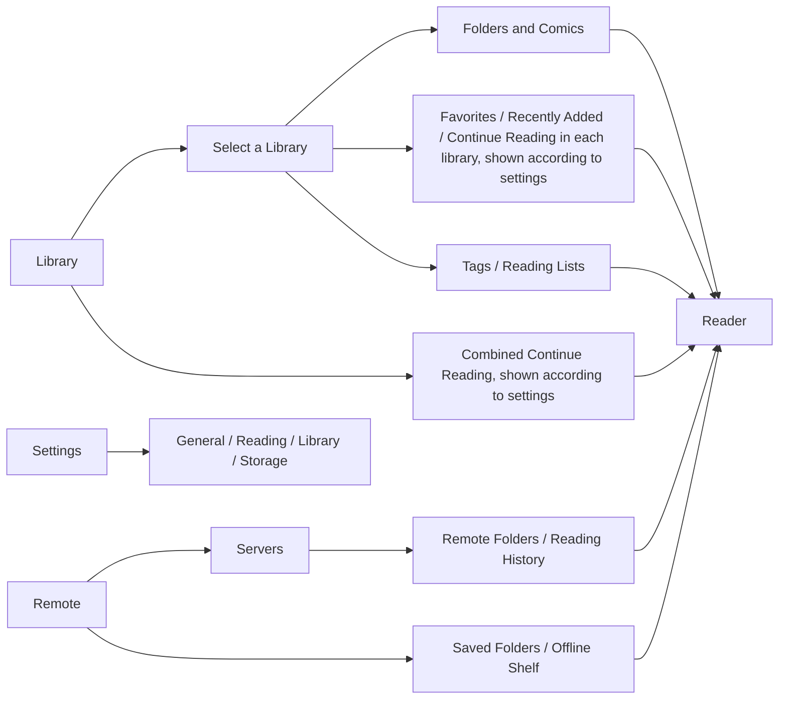

# JamReader UI/UX Requirements and Current State

For UI/UX designers · Current capabilities, workflows, and maintenance constraints

**Goal: make comics easy to find, read, and manage while preserving the tuned comic-reading interactions.** Interface changes must preserve the current behavior of the bottom navigation list in paged reading and the side navigation list in vertical reading. See section 5.

This document describes existing capabilities in code and the data boundaries and interaction constraints that maintenance must preserve. See [implementation decisions and capability limits](design-system/05-batches.md) for differences between implementation and static mockups. Documentation does not replace device, interaction-feel, or accessibility acceptance checks.

See the [design system](design-system/README.md) for information architecture, entry placement, visual tokens, and component and page rules. This document owns business requirements, data boundaries, deletion consequences, and the reader behavior contract.

## 1. Product and Use Cases

JamReader is a personal comic reader and manager for iPhone and iPad. Comics come from the user's own files, folders, or NAS/servers.

| What the user wants | What the product must help them do |
| --- | --- |
| Everyday reading | Find the last unfinished comic, continue reading, and remember progress after leaving |
| Organize a collection | Import files, find books by folder, tag, or reading list, and edit titles and other metadata |
| Read NAS comics | Connect over SMB/WebDAV, browse folders, read directly, or save copies for offline use |
| Manage space | Understand which data is their own comics and which is rebuildable cache before choosing what to clean up |

**Give equal weight to local libraries and remote reading, with a quiet, content-first, native iOS/iPadOS style.** Preserve existing comic-reader interactions as specified in section 5.

See section 8 for the boundary of feature expansion.

## 2. Distinguish These Concepts First

| Concept | Meaning the user needs to understand |
| --- | --- |
| App Managed | A local collection space created by the user; the app stores its comic files |
| Imported Comics | The app's default import library; like user-created libraries, it contains user files |
| Linked Folder | Uses a folder selected in Files directly, without copying all comics when added; availability depends on folder permission |
| Tags / Reading Lists | Logical groups within one local library; they do not copy or move comic files. Favorites and page bookmarks also serve different purposes |
| Saved Folders | Shortcuts to remote folders; saving a shortcut does not download its comics |
| Offline Copy | A remote comic explicitly saved to this device by the user; it still belongs to that server and does not automatically enter a local library |
| Reading cache | Temporary data or automatically downloaded copies from online reading; cached content is not necessarily on the Offline Shelf |

**A linked folder is not necessarily read-only.** With write permission, users can import files into it and delete comics from it. App metadata such as titles, tags, and reading progress still stays in the app. When read-only, preserve reading and metadata management and explain why import and file deletion are unavailable.

“Import to Library” and “Save Offline Copy” must remain distinct actions. A remote comic that can already open offline is not necessarily present in a local library.

## 3. Feature Map

The three logical areas are Library / Remote / Settings. The diagram shows existing feature relationships; see section 6 for entry placement and page reuse.

### Local Libraries

| Page or task | Existing capabilities | Maintenance constraints |
| --- | --- | --- |
| Library Home | Create libraries, link folders, import files or folders; rename libraries, view info, remove or delete | Explain Add methods by purpose so new users need not learn storage terminology first |
| Library contents | Browse folder levels, system back navigation and tappable breadcrumbs, tap comics to read; import files into the current folder; refresh the whole library or current folder | Make current location and import target clear; keep scanning and other maintenance actions secondary |
| Find books | Search folders and comics in the current library; sort; switch grid/list on both iPhone and iPad | State the search scope, distinguish Empty Folder from no search results, and do not imply search across all servers |
| Continue Reading and collections | Combined or per-library Continue Reading; separate entries for Favorites, Recently Added, Tags, and Reading Lists | Prioritize covers, names, and reading progress; make groups easy to find and avoid crowding covers with status labels |
| Comic management | Favorite, read/unread, rate 1–5 stars or Clear Rating, Edit Metadata, Tags/Reading Lists, delete files | Separate lightweight actions from deletion; common actions must not be discoverable only through long press |
| Batch management | Multiselect, Select All, batch read/favorite status, metadata edits, tag/reading-list additions and removals, ComicInfo import | Make selected count and scope clear; restore normal opening behavior after selection mode ends |
| Tags and Reading Lists | Create, rename, set tag colors, delete groups; add/remove comics; search and sort | Do not call removing from a group Delete Comic or present grouping as file copying |
| Metadata editing | Title, series, volume/issue, type; publication, creators, characters, synopsis, notes, and more; read ComicInfo.xml | Put common fields first and expand detailed fields in groups; batch edits change only checked fields; offer an explicit choice on leaving with unsaved changes |

Current details:

- Local “Recent” means **recently added to the library**, with 7-, 14-, 30-, or 90-day windows, not reading history. The UI consistently calls it Recently Added.
- Continue Reading contains opened but unfinished comics. [ContinueReading](design-system/components/ContinueReading/README.md) owns placement and presentation. Combined results query each library separately (up to 20 comics per library, 10 shown on the home page), identify entries by library + row ID, and allow previous/next comic navigation only within that library after opening. Remote reading history stays in each server's detail page and is not merged into the local summary.
- Local browsing defaults to a cover grid, can switch to a list, and saves the preference. Accessibility text sizes use a two-column grid. The current folder offers All, Unread, In Progress, Read, and With Bookmarks filters; folders are unaffected.
- Local-library search currently returns at most 40 folders and 40 comics, not unlimited complete results. Removing the cap or adding global search requires a separate feature requirement.
- Collection content pages can search within the current collection. Favorites, Recently Added, Tags, and Reading Lists offer All / Unread / In Progress / Read / With Bookmarks quick filters (Continue Reading is already In Progress and shows no filter). Filters and search can apply together. Empty results state all conditions (for example, no comics in Recently Added match both In Progress and “Night”) and offer Show All.
- ComicInfo is metadata inside comic files. Existing scopes include Selected Comics, Current List, Entire Library, and This Folder and Subfolders. Users can choose Fill Empty Fields or Overwrite Existing Fields. Entry changes must not merge away these scope differences.
- Library renaming and comic metadata edits change only display metadata inside the app; they do not rename source files or folders. There are no existing actions for moving local files or renaming source files.

### Remote Browsing and Offline Reading

| Page or task | Existing capabilities | Maintenance constraints |
| --- | --- | --- |
| Remote home | Offline Shelf and Saved Folders across all servers at the top; server list below shows name, address, and protocol | Do not infer connection status; the empty state keeps only one Add Server action |
| Add/Edit Server | Protocol-specific fields and examples; retain input on error; confirm cleanup impact before changing location or account; confirm leaving with unsaved changes | Saving configuration does not connect to the server; mask passwords |
| Server details | A single primary Browse Files button opens the last directory; a Continue Reading hero card and strip show history; server shortcuts keep folders and Offline Shelf | The menu keeps only Edit, Clear Reading History, Clear Downloads on This Device, and Delete Server; long-press history cards to remove one entry |
| Remote directory | Inline folder title, tappable breadcrumbs, pin to save/unsave, grid/list, sort by name/update/size | Unsupported files are only counted; View As and batch actions live in More |
| Single comic | Tap the cover to read; menu grouped by On This Device, local library, and Info; older copies offer Update Copy and an explicit Open Older Local Copy action | Only explicitly saved full copies show Available Offline; ordinary reading cache must not appear as offline saving |
| Whole folder | Import the current folder with an include-subfolders choice; batch save or remove local copies of comics in the current directory | Explain scope and destination before starting; do not describe the current directory as the whole server |
| Saved Folders | Group by server, search; navigation-bar Edit supports rename/remove; pin markers; tap to enter a directory | Removal confirmation makes clear that only the shortcut is deleted and server files remain |
| Offline Shelf | Search, All/Needs Update filters with counts, sort; open/remove copies; trailing update action for older copies while online | When the system reports no network, show a notice and hide update and remote-directory actions; no whole-server clear action |

Current details:

- Saving server configuration only validates and saves it; **it does not mean the connection succeeded**. The current form has no separate Test Connection feature.
- Remote directories currently have no search field. Do not draw recursive search, cross-server search, or remote file rename/move/delete as existing features.
- ZIP/CBZ can fetch pages while reading when the server supports it. Other formats or servers without that reading capability require downloading first. An open failure does not guarantee automatic fallback to another method.
- Remote-reading preparation and failure feedback use the unified reader. See [reading preparation](design-system/components/ScreenRemoteActions/README.md) for covers, progress, cancellation, and Edit Server presentation.
- Remote import still writes to the target library root. The current directory can show its listed comic count; recursive totals are counted during import. There is no prescanned total or target-subfolder picker. See [FormField](design-system/components/FormField/README.md) for WebDAV form fields.
- Server history still uses the existing query scope inside the detail page. There is currently no separate all-remote-history collection page. An available network path does not mean the NAS is reachable; failed updates still show the actual error.
- Reading cache may be cleaned automatically. Explicitly saved offline copies are protected from automatic cleanup but are still deleted when users explicitly clean downloaded copies.
- Remote reading history and local-library progress are stored separately. Importing the same remote comic into a library must not be described as automatically synchronizing both progress records.
- Offline Shelf currently has no direct Import to Library button. Return to the remote directory and use the comic's import action. Reuse that path during maintenance rather than creating a second import flow.

### Settings

| Category | Existing settings and features |
| --- | --- |
| General | Launch into the last-used area, Library, or Remote; app version |
| Reading | Keep the screen awake while reading; shared reading-layout defaults; restore recommended defaults |
| Library | Continue Reading placement, Recently Added time window, default remote-folder import scope |
| Storage | Remote Downloads, Rebuildable Data, and Your Files sections; each row shows size and a cleanup button, with consequences in confirmation dialogs; the top usage bar counts only categories this page can query |

Storage opens management directly. Do not combine user files and cache into one one-tap cleanup. The download limit is an automatic-cache policy, not a guarantee that total app usage always stays below it. Files being read and explicitly saved offline copies affect reclaimable space.

See [storage implementation limits](design-system/05-batches.md#remote-and-storage) for the usage-bar scope and [section 7](#deletion-removal-and-cleanup) for cleanup consequences.

Download Full Copy While Reading only affects automatic downloads of remote comics that support streaming. It does not cancel downloads required to open a file or change explicit Save Offline Copy actions.

## 4. Key Workflows

These are the existing steps. Changes to surrounding flows must preserve the meaning of choices, cancellation paths, and final results.

| Scenario | Steps | Success and failure criteria |
| --- | --- | --- |
| First local comic import | Library → Add Comics → Import Comics → select target library → Choose Files/Choose Folder → system file picker → task banner → open target library | Complete only after indexing into the library; show actual succeeded, skipped, and failed results. Importing files from a library content page uses the current library/folder directly without choosing the target again |
| Use an existing folder | Add Comics → Use Existing Folder → system authorization picker → open library → initialize/scan if needed | Files stay in place; show expired permission separately from an empty library |
| Continue local reading | Continue Reading on Library Home (or in the relevant library when set to Inside Each Library) → comic → saved location → exit to the original list | Update progress on the cover item after returning; preserve current location and group rather than returning home |
| First remote read | Remote → Add Server → Save → server details → directory → comic | Open if streaming is supported; otherwise show download preparation progress and allow cancellation; provide appropriate actions for sign-in/network/path errors |
| Prepare offline reading | Remote comic actions → Save Offline Copy → completion → Offline Shelf → open | Mark available offline only for a complete usable copy; failure or interruption must not appear complete; older copies may offer an update |
| Import remote content into a local library | Comic/folder actions → Import to Library → choose target and directory scope → download → index into library → open target library | Content is findable in the target library afterward; distinguish partial success, indexing failure, and cancellation |
| Organize multiple comics | Content page → Select → check comics → action → Apply → finish selection | Make the edit target clear and leave unselected comics unaffected; removing from a list does not delete files |
| Clean up space | Settings → Storage → choose data category → read impact → confirm → cleanup result | Refresh usage and offline state; explain active use or task conflicts rather than pretending success |

Imports allow cancellation and must report completed work accurately. Remote imports can continue while navigating within the app, and their progress entry must stay easy to find. This does not establish reliable resumption after app exit, system suspension, or restart; mockups must not promise it.

On repeated imports, the existing import service reuses identical content recognized at the target location. Same-name files with different contents receive a numeric suffix to preserve both. Completed count need not equal newly added count. Do not add overwrite confirmation or promise whole-library deduplication.

## 5. Comic Reader: Protected and Editable Areas

**Preserve both navigation lists unchanged: the bottom thumbnail navigation list in paged reading and the right-side thumbnail navigation list in vertical continuous reading.** Reuse the existing components directly. Do not change their position, dimensions, spacing, thumbnail style, animation, visibility, touch handling, or page-jump behavior, or include them in surrounding entry consolidation. Changes to nearby tools or shared styles must not affect them indirectly.

Other reader UI may change toolbar appearance, icons, fonts, colors, panel hierarchy, and tool placement while preserving existing reading behavior. Any proposal that changes the meaning of an action below must be called out separately and confirmed by the product owner, not bundled into visual polish.

| Behavior to preserve | Design constraint |
| --- | --- |
| Paged reading | Keep horizontal swipes, edge taps to turn pages, and center taps to toggle tools; do not redefine touch regions or change gesture-response timing |
| Vertical continuous reading | Keep continuous vertical scrolling, full-page width, and existing zoom/pan; do not apply paged-mode tap rules |
| Exit reading | Swipe down in paged mode and right in vertical continuous mode; the explicit back button remains available. Zoom and content panning take priority to prevent accidental exits |
| Zoom | Preserve paged double-tap/pinch and vertical canvas pinch/pan as implemented; cancelling a page turn must not lose current zoom |
| Reading viewport | Showing or hiding tools does not squeeze or resize the comic; tools respect system safe areas; rotation and iPad window changes keep the current page stably positioned |
| Quick paging | Preserve both UI and interaction of the paged bottom navigation list and vertical right-side navigation list unchanged; keep the vertical compact page-number entry |
| Vertical track | Preview during dragging and commit one page jump only on release; cancellation keeps the original page. Track interaction must not trigger exit, and hidden tools must not leave invisible touch regions |
| Find an exact page | Keep page-number input, thumbnail overview, current-page location, page bookmarks, and jumping; clearly explain invalid page numbers |
| Cross-comic reading | Keep previous/next logic and edge behavior for the local opening sequence; do not silently change it to automatic next-comic navigation or extend it to remote continuous reading |
| Layout settings | Keep paged/vertical mode, single/double page where supported, left/right spread order, first page alone/paired, fit mode, and page spacing; show controls according to capability |
| Setting scope | Layout options persist as shared defaults for later comics; rotation is an action in the current reading session. Do not design per-comic memory |
| Progress and additional actions | Preserve progress on return/background restoration; keep local favorites, read status, ratings, and metadata editing; supported pages can save to Photos with authorization and failure handling |

Current behavior designers need to know:

- In vertical mode, when tools are hidden and a local multi-comic sequence exists, edge taps attempt to open the previous/next comic. When tools are visible, edge taps hide them. Do not redraw the interaction on the assumption that both side edges should turn one page. Review the interaction feel against the current version.
- Double Page is available only in supported wider layouts; Spread Order controls only the left/right order of the two pages. Vertical mode hides Double Page, Fit Mode, and Rotation entries; Page Spacing remains available.
- Reaching the last page produces read progress. Manual Mark as Unread/Mark as Read also adjusts reading position; it is not just a badge change.
- Local comics support up to 3 page bookmarks each; remote comics do not have the same count limit. At the local limit, tapping the bookmark shows a system Alert to replace an existing bookmark with the current page in one write, not delete then add. Changing the limit is a separate feature change requiring confirmation.
- See [reader tool layout](design-system/03-reader.md#tool-layout) for the top bar, display panel, and More menu. The old full-screen control panel has been removed; layout changes affect the view immediately.
- The reader enables double pages by window width; temporary single-page mode in a narrow window does not overwrite the saved preference. See [iPhone Duo](design-system/06-iphone-duo.md) for navigation tiers and crease adaptation that is not yet connected.
- Local metadata editing, favorites, ratings, and similar actions are not fully available for remote comics. Do not give remote entries the same management panel when its actions cannot complete.
- PDF reading depends on a PDF engine being included in the build. PDF/EPUB rendered as pages uses a fixed single-page layout; EPUB may also use a separate web reader. Do not assume every format has comic layout, page-number, or bookmark controls. See the [product overview](../README.md#highlights) for the full format list.

## 6. Interface Organization and Maintenance

### Entry Consolidation and Page Reuse

[Information architecture](design-system/02-architecture.md#entry-placement-and-page-reuse) owns entry placement, scope reuse, and deduplication rules. Local and remote data retain the boundaries in sections 2, 4, and 7.

See [design foundations](design-system/00-foundations.md) for visual values and copy, [window adaptation](design-system/06-iphone-duo.md) for window-width changes and sidebar restoration, and [project context](project-context.md#runtime-shape) for the minimum OS and engineering boundaries.

[UI guidelines](ui-guidelines.md#change-checklist) owns checks for text scaling, light/dark mode, screen readers, Reduce Motion, and all four languages.

## 7. Required States and Action Explanations

### Page States

| State | What mockups must communicate |
| --- | --- |
| First use / no content | Explain what users can do here and offer one primary next step; do not leave a blank page |
| Content / lots of content | Long titles, deep directories, many covers, and missing covers remain identifiable and usable |
| Loading or preparing to read | Preserve the current source and explain what is being processed; cancellable flows have a clear cancel action |
| No search results | Show search scope and allow clearing conditions so users do not mistake it for deleted comics |
| Expired folder permission / read-only | Distinguish inaccessible from unwritable; provide actionable recovery guidance. There is currently no in-place reauthorization entry; do not draw a nonfunctional button |
| Network / sign-in / path error | Preserve location and input; provide suitable exits such as Retry, Edit Server, or existing offline content |
| Partial success / cancellation | Show how much completed, what did not, and what can happen next; do not show a blanket Import Complete |
| Insufficient space / save failure | Preserve input and usable content, explain unfinished work, and offer retry or storage management; do not automatically delete user files for space |
| Unsaved changes | Make Save, Keep Editing, and discard meanings clear; prevent swiping away from losing metadata |
| Unsupported format or reading capability | Explain what cannot open or which action is unavailable; do not show ineffective controls |
| Task or reader in use | Explain why cleanup, connection changes, or conflicting tasks are temporarily unavailable; preserve the current task entry |

### Deletion, Removal, and Cleanup

These are the existing data boundaries; confirmation copy must state these consequences. “Preserved” in the table does not allow omitting error feedback on failure.

| Action | Actual effect |
| --- | --- |
| Remove comics from a tag/reading list, or delete the group | Removes group relationships, not comic files |
| Remove a linked-folder library | Removes the library and organization records from the app; preserves the source folder |
| Delete an app-managed library | Deletes the library and its comic files on this device |
| Delete Imported Comics | Deletes the library and its files; it remains the default import destination, and a later import into Imported Comics recreates an empty library |
| Delete a local comic | Deletes the library record and actual file; files in linked folders may also be deleted |
| Remove a remote-folder shortcut | Removes only the shortcut; preserves server files |
| Remove a single/current-directory copy, or clear downloads in Settings or server management | Deletes local copies of remote files in that scope; preserves server files and reading history; network access may be needed afterward |
| Delete one remote reading-history entry / clear history | Preserves downloaded files; removes history, progress, and page-bookmark records for that comic/all comics on that server |
| Delete a server | Removes configuration, saved credentials, related local downloads, history, and folder shortcuts; preserves server source files |
| Change server location or access identity | May clear history, shortcuts, and local copies tied to the old location; explain this impact before saving |
| Clean up Temporary Data / Remote Covers | Removes the corresponding rebuildable data, not local-library comics; rebuildable does not mean no network is needed |
| Empty Imported Comics | Deletes user files in the default import library and leaves it empty; does not empty every library or clear cache |

Batch actions must show count and scope. Actions affecting source files use an explicit confirmation page/dialog. Do not hide permanent deletion behind Remove, or promise Undo where no recovery mechanism exists.

Offline Shelf has no whole-server clear action. Old uncalled methods still have different consequences; do not reuse them during maintenance. See [implementation limits](design-system/05-batches.md#remote-and-storage).

## 8. Maintenance and Review

Use library contents, remote directories, reader tools, and import flows as representative scenarios for interface changes. See the [design system](design-system/README.md) for page mockups, section 7 for state checks, and [development workflow](development-workflow.md#validation-by-change-type) for validation.

Review by walking through real tasks: find the result of a first import; continue an unfinished comic; distinguish offline saving from importing; recover from partial failure; explain what cleanup will delete before confirming; and check for new accidental exits, page turns, or lost reading positions. Consolidated entries must still support the original tasks.

The following remain **feature expansions requiring separate confirmation**: accounts / cloud sync, content store / community, combined local and remote Continue Reading, global / remote search, progress sync, a higher local bookmark limit, redesigned reading gestures, local / remote source-file rename and move, remote source-file deletion, guaranteed download resumption after app exit, and Test Connection. Do not draw them as existing capabilities.

## Maintenance Appendix: Verification Sources and Document Ownership

Use these to locate behavior during maintenance. Test files identify regression coverage entry points, not device acceptance results.

| Area to verify | Main sources |
| --- | --- |
| Three main entries, startup, and settings | [Navigation](../JamReader/App/AppNavigationSupport.swift), [settings categories](../JamReader/Features/Settings/SettingsSections.swift) |
| Local entries, search, and collections | [Library Home](../JamReader/Features/Libraries/LibraryHomeView.swift), [library contents](../JamReader/Features/Browser/LibraryBrowserView.swift), [queries and state](../JamReader/Data/Libraries/NativeLibraryState.swift) |
| Import, writability, and cancellation | [Import service](../JamReader/Data/Libraries/ImportedComicsImportService.swift), [import tests](../JamReaderTests/ImportedComicsImportServiceIntegrationTests.swift) |
| Remote actions, scopes, and offline use | [Directory UI](../JamReader/Features/Remote/RemoteServerBrowserView.swift), [server details](../JamReader/Features/Remote/RemoteServerDetailView.swift), [Offline Shelf](../JamReader/Features/Remote/RemoteOfflineShelfView.swift), [server saving and cleanup](../JamReader/Features/Remote/RemoteServerListViewModel.swift), [reading-progress preservation tests](../JamReaderTests/RemoteServerListViewModelTests.swift) |
| Deletion and cache | [Local deletion service](../JamReader/Data/Libraries/LibraryComicRemovalService.swift), [storage UI](../JamReader/Features/Settings/RemoteCacheSettingsView.swift), [cache policy](../JamReader/Data/Remote/RemoteCachePolicyStore.swift) |
| Reader entry, capabilities, and settings | [Reader](../JamReader/Features/Reader/ComicReaderView.swift), [reading state](../JamReader/Features/Reader/ComicReaderViewModel.swift), [shared preferences](../JamReader/Data/Reader/ReaderLayoutPreferencesStore.swift), [preference tests](../JamReaderTests/ReaderPreferenceStoreTests.swift) |
| Reading gestures and quick navigation | [Paged container](../JamReader/SharedUI/Components/ImageSequenceReaderContainerView.swift), [vertical container](../JamReader/SharedUI/Components/VerticalImageSequenceReaderContainerView.swift), [thumbnail track](../JamReader/SharedUI/Components/ReaderVerticalThumbnailRail.swift), [dismissal gesture tests](../JamReaderTests/ReaderDismissGestureDirectionTests.swift) |
| Format capability differences | [Document loading](../JamReader/Data/Reader/ComicDocumentLoader.swift), [content presentation](../JamReader/SharedUI/Components/ReaderDocumentComponents.swift) |

This document owns design requirements; the [design system](design-system/README.md) owns interface rules. See the [documentation index](README.md) for engineering-document ownership. Update the responsible document directly rather than adding duplicate design notes, audit reports, or completion checklists.
